# bdget - Microservicio Base DevOps

> **Nota de entrega:** esta evaluación se realizó de forma **individual**, con autorización del docente.
>
> **Repositorio base:** extiende el pipeline de la Evaluación 2 con despliegue en Kubernetes, observabilidad, dashboard y políticas de cumplimiento automatizadas.

## Propósito

**bdget** es un microservicio desarrollado en **Spring Boot 3 (Java 17)** que expone una API REST para la gestión de estudiantes (`Student`), conectado a una base de datos Oracle. Este repositorio es la base del pipeline DevOps de la asignatura Ingeniería DevOps (DOY0101): control de versiones con Git/GitHub y automatización de integración, seguridad, contenedores, despliegue en Kubernetes, observabilidad y cumplimiento con GitHub Actions.

## Instrucciones de configuración e instalación

### Requisitos previos
- Java 17 (JDK)
- Maven (o usar el wrapper incluido `mvnw` / `mvnw.cmd`)
- Una instancia de base de datos Oracle y su wallet (o Docker, ver más abajo)

### Clonar el repositorio
```bash
git clone https://github.com/cristian2434/ing-devops-ev.-parcial-3.git
cd ing-devops-ev.-parcial-3
```

### Configurar la base de datos
Edita `src/main/resources/application.properties` y reemplaza los valores de conexión:
```properties
spring.datasource.url=<db_url>
spring.datasource.username=<db_username>
spring.datasource.password=<db_password>
```
Los valores reales nunca se suben al repositorio. En el contenedor llegan por variables de entorno (`SPRING_DATASOURCE_*`).

### Ejecutar el proyecto localmente
```bash
./mvnw spring-boot:run
```
La aplicación queda disponible en `http://localhost:8081`.

### Ejecutar con Docker Compose
Requiere un archivo `.env` (no versionado) con las credenciales y la carpeta `wallet/` de Oracle en la raíz del proyecto (no versionada):
```bash
# .env
DB_TNS_ALIAS=<alias_tns>
DB_USERNAME=<usuario>
DB_PASSWORD=<contraseña>
```
```bash
docker compose up --build
```
El servicio queda en `http://localhost:8081` y se verifica con `curl http://localhost:8081/api/health`.

### Ejecutar los tests
```bash
./mvnw test
```

## Ejemplos de uso

| Método | Endpoint | Descripción |
|---|---|---|
| `GET` | `/students` | Lista todos los estudiantes |
| `GET` | `/students/{id}` | Obtiene un estudiante por ID |
| `GET` | `/students/search?name=juan` | Busca estudiantes por nombre (parcial, sin distinguir mayúsculas) |
| `POST` | `/students` | Crea un nuevo estudiante |
| `PUT` | `/students/{id}` | Actualiza un estudiante existente |
| `DELETE` | `/students/{id}` | Elimina un estudiante |
| `GET` | `/api/health` | Verifica el estado del servicio |

Ejemplo con `curl`:
```bash
curl http://localhost:8081/students/search?name=maria
```

---

## Estrategia de Ramificación: GitFlow

### ¿Qué son GitFlow y Trunk-Based Development?

**GitFlow** es una estrategia de ramificación estructurada que organiza el desarrollo en ramas específicas:
- **main** (producción)
- **develop** (desarrollo)
- **feature** (nuevas funcionalidades)
- **release** (preparación de versiones)
- **hotfix** (correcciones urgentes)

**Trunk-Based Development (TBD)** es un enfoque más ágil donde todos los desarrolladores integran sus cambios frecuentemente en una única rama principal (`main` o `trunk`), usando ramas de corta duración que se fusionan rápidamente.

### Justificación de la elección

Elegí **GitFlow** para este proyecto porque:
- Separa claramente el código en producción (`main`) del código en desarrollo activo (`develop`), lo cual da estabilidad mientras se integran nuevas funcionalidades.
- Permite trabajar features de forma aislada (`feature/<nombre>`) sin afectar la rama estable, manteniendo trazabilidad clara de qué cambio corresponde a qué propósito.
- Facilita correcciones urgentes mediante ramas `hotfix/<nombre>`, que se crean desde `main` y se integran tanto a `main` como a `develop`, sin interrumpir el desarrollo en curso.
- En un entorno colaborativo en la nube (GitHub), GitFlow da control explícito sobre qué llega a producción mediante Pull Requests revisados, lo cual es apropiado para un proyecto académico donde se evalúa el proceso, no solo el resultado final.
- A diferencia de Trunk-Based Development —que exige integración continua muy frecuente y una suite de pruebas automatizadas robusta para minimizar riesgos de romper `main`—, GitFlow se adapta mejor a un ritmo de trabajo con avances puntuales, no despliegues varias veces al día.

### Estructura de Ramas del repositorio
- `main`: código estable, listo para producción. Un push a esta rama dispara el despliegue.
- `develop`: rama de integración, donde se juntan los cambios antes de pasar a `main`.
- `feature/<nombre>`: nuevas funcionalidades, creadas desde `develop` y mergeadas de vuelta a `develop`.
- `hotfix/<nombre>`: correcciones urgentes, creadas desde `main` y mergeadas tanto a `main` como a `develop`.

---

## Convenciones de Commits

Formato: `tipo: descripción breve en presente`

| Tipo | Uso |
|---|---|
| `feat:` | nueva funcionalidad |
| `fix:` | corrección de un bug |
| `docs:` | cambios de documentación |
| `chore:` | tareas de mantenimiento (configuración, dependencias, etc.) |
| `test:` | agregar o modificar tests |
| `ci:` | cambios en la configuración de integración continua |
| `sec:` | cambios de seguridad (por ejemplo, política de Snyk) |

Ejemplos reales usados en este repositorio:
- `feat: agregar busqueda de estudiantes por nombre`
- `feat: agregar endpoint de health check`
- `fix: capturar ruta real de la peticion y eliminar imports duplicados`
- `ci: usar nombre de imagen valido para GHCR`
- `sec: registrar riesgos aceptados de Snyk con vencimiento`

## Naming de Ramas

- `feature/nombre-corto-descriptivo` (ej. `feature/busqueda-por-nombre`, `feature/health-check`)
- `hotfix/nombre-corto-descriptivo` (ej. `hotfix/ruta-real-en-errores`)

## Estructura de Carpetas

```
.github/
├── dependabot.yml        # Actualización automática de dependencias
└── workflows/main.yml    # Pipeline CI/CD (7 jobs)
docs/img/                 # Capturas de evidencia del pipeline
src/main/java/com/example/bdget/
├── controller/           # Endpoints REST (StudentController, HealthController)
├── service/              # Lógica de negocio (interfaz + implementación)
├── repository/           # Acceso a datos (Spring Data JPA)
├── model/                # Entidades (Student)
└── exception/            # Manejo global de excepciones
src/test/java/com/example/bdget/
└── ...                   # Tests unitarios por capa (controller, service, model, exception)
web/                      # Página estática publicada en Apache (EC2)
Dockerfile                # Imagen multi-etapa
docker-compose.yml        # Ejecución local (el despliegue real usa k8s/)
k8s/                      # Manifiestos de Kubernetes (namespace, service, deployment)
monitoring/dashboard.json # Dashboard de CloudWatch versionado
scripts/                  # audit-k8s.py, publish-observability.sh, health-metric.sh
.trivyignore              # CVE aceptados para Trivy, con vencimiento
.snyk                     # Política de Snyk (riesgos aceptados con vencimiento)
```

## Control de Versiones y Flujo de Merge

1. Los cambios se desarrollan en `develop` (o en ramas `feature/` y `hotfix/`) y llegan a `main` **solo mediante Pull Request**.
2. Se verifica que el pipeline de GitHub Actions pase correctamente antes de mergear cada PR.
3. Los `hotfix`, una vez mergeados a `main`, también se mergean a `develop` para mantener sincronizadas ambas ramas.
4. Las ramas ya mergeadas se eliminan para mantener el repositorio limpio.

## Estrategia de Revisión

- Ningún cambio llega a `main` sin pasar por un Pull Request, aunque se trate de un único desarrollador, para dejar registro formal y trazable de cada cambio.
- El PR describe brevemente qué cambia y por qué.
- Se revisa que el pipeline de CI (seguridad, tests, calidad y build) pase en verde antes de aprobar el merge.
- Se prioriza revisar: consistencia de nombres, que el cambio no rompa funcionalidad existente, y que incluya sus pruebas correspondientes si aplica.

---

## Arquitectura de la solución (Evaluación 3)

Este repositorio extiende el pipeline de la Evaluación 2 con tres capas nuevas: **despliegue en Kubernetes**, **observabilidad** y **cumplimiento automatizado**. La trazabilidad cubre todo el recorrido: commit → Pull Request → pipeline → imagen → despliegue → monitoreo.

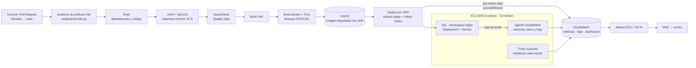

Los jobs de calidad y seguridad están encadenados con `needs`, de modo que **el despliegue solo ocurre si todos los anteriores terminaron en verde**.

### Cómo se integra cada herramienta

| Herramienta | Dónde se integra | Qué decide | Indicador |
|---|---|---|---|
| `scripts/audit-k8s.py` | Job `policy-audit` (primer job) | Revisa los manifiestos de `k8s/` contra 9 políticas. Si alguna falla, el pipeline se detiene antes de gastar tiempo en el resto. | IE5, IE6 |
| Snyk | Job `snyk-scan` | Bloquea con vulnerabilidades altas o críticas en dependencias o código. | IE5, IE6 |
| JUnit + JaCoCo | Job `test` | Bloquea si la cobertura de líneas baja de 70 %. Además publica el porcentaje medido, que se usa en el dashboard. | IE3, IE6 |
| SonarCloud | Job `sonar` | Espera el Quality Gate; si falla, se detiene el pipeline. | IE5, IE6 |
| Trivy | Job `docker` | Escanea la imagen **antes** de subirla a GHCR; una vulnerabilidad `CRITICAL` con parche disponible detiene el pipeline. | IE5, IE6 |
| Branch protection (`proteger-main`) | Settings → Rules | Exige Pull Request y los 5 checks obligatorios (ver más abajo). | IE5 |
| k3s (Kubernetes) | Job `deploy` | `kubectl apply` y `rollout status`; si el rollout falla, ejecuta `rollout undo` y marca el job en rojo. | IE2 |
| Spring Boot Actuator + Micrometer | `pom.xml` y `application.properties` | Expone solo `health`, `info` y `prometheus`. `/actuator/health` alimenta la disponibilidad. | IE1 |
| Agente de CloudWatch | EC2 | Envía memoria y disco, y los logs de los pods al grupo `/bdget/app`. | IE1 |
| CloudWatch (métricas, alarma, dashboard) | EC2 + job `deploy` | Dashboard versionado en `monitoring/dashboard.json`; alarma de CPU con aviso por correo (SNS). | IE1, IE3 |

---

## Pipeline CI/CD — GitHub Actions

El pipeline está definido en `.github/workflows/main.yml`. Se ejecuta en cada **push a `main` y `develop`** y en cada **Pull Request hacia `main`**. Si llega un nuevo push a la misma rama, se cancela la ejecución anterior (`concurrency`).

Los siete jobs están **encadenados con `needs`**: cada uno solo corre si el anterior terminó bien. Si uno falla, los siguientes se omiten.

```
Auditoría de políticas K8s → Snyk → JaCoCo → SonarCloud → Build JAR → Build Docker Image (+ Trivy) → Deploy (Kubernetes k3s)
```

| Job | Qué hace | Indicador |
|---|---|---|
| `policy-audit` | Ejecuta `python3 scripts/audit-k8s.py k8s` y falla si algún manifiesto incumple una política. | IE5, IE6 |
| `snyk-scan` | `snyk test` (dependencias) y `snyk code test` (código). Falla con severidad **alta o crítica**. Guarda el reporte JSON como artefacto. | IE5, IE6 |
| `test` | `mvn clean verify`: 19 pruebas unitarias y verificación de cobertura con JaCoCo (mínimo 70 %). Calcula la cobertura total y la entrega al job de despliegue. | IE3, IE6 |
| `sonar` | Análisis de calidad con SonarCloud y espera el Quality Gate (`sonar.qualitygate.wait=true`). | IE5, IE6 |
| `build` | Empaqueta el JAR y lo sube como artefacto. | IE2 |
| `docker` | Construye la imagen **sin publicarla**, la escanea con Trivy (`severity: CRITICAL`, `ignore-unfixed`, `exit-code: 1`) y solo si pasa, y estamos en `main`, la publica en GHCR. | IE5, IE6 |
| `deploy` | Solo en push a `main`, con el entorno `produccion-simulada`. Por SSH a la EC2: crea el namespace y los Secrets (wallet de Oracle y credenciales, desde los secretos de GitHub), aplica los manifiestos, espera el rollout (con `rollout undo` si falla), hace una prueba de humo a `/api/health`, publica la página web y **publica el tiempo de despliegue, la cobertura y el dashboard en CloudWatch**. | IE2, IE3 |

En un Pull Request el pipeline llega hasta `docker` (construye y escanea la imagen sin publicarla); el despliegue ocurre únicamente tras el merge a `main`.

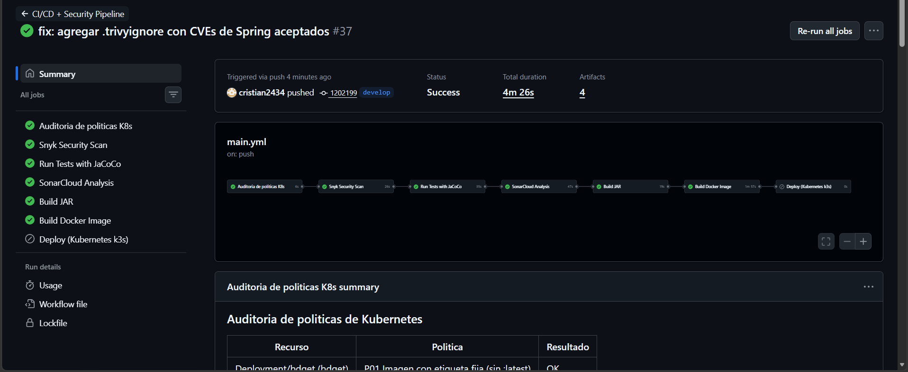
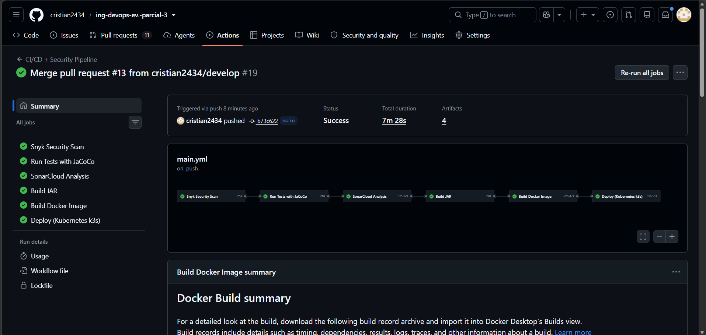

### Contenedores
- `Dockerfile` multi-etapa: dependencias (caché de Maven), compilación con JDK 17 y ejecución con imagen **JRE 17**, más liviana.
- Se ejecuta con un usuario no root (`appuser`, UID 1001).
- `.dockerignore` excluye `target/`, credenciales, wallet y documentación, para que no entren a la imagen.
- Los secretos nunca están en la imagen: se inyectan como variables de entorno desde Secrets de Kubernetes y el wallet se monta como volumen de solo lectura.
- `docker-compose.yml` se conserva solo para ejecutar el servicio de forma local.

### Orquestación en Kubernetes (IE2)
El despliegue usa **k3s** (Kubernetes real, ligero) instalado sin Traefik en una instancia **EC2 `t3.medium`** de AWS Academy, porque el puerto 80 lo usa Apache. El pipeline entra por SSH, igual que en la evaluación anterior, por lo que no requiere credenciales de AWS en GitHub.

Manifiestos en `k8s/`:
- `namespace.yaml`: namespace `bdget`.
- `service.yaml`: Service `LoadBalancer` en el puerto 8081.
- `deployment.yaml`:
  - Imagen parametrizada (`__APP_IMAGE__`), reemplazada en cada despliegue por la etiqueta del SHA del commit.
  - `startupProbe`, `livenessProbe` y `readinessProbe` sobre `/api/health`.
  - `requests` (250m CPU, 512Mi) y `limits` (1 CPU, 1Gi).
  - `securityContext`: `runAsNonRoot`, `runAsUser: 1001`, `allowPrivilegeEscalation: false` y `capabilities.drop: ALL`.
  - Anotaciones `prometheus.io/*` apuntando a `/actuator/prometheus`.
  - Credenciales y wallet de Oracle tomados de Secrets (`db-credentials` y `oracle-wallet`), creados por el pipeline desde los secretos de GitHub.

El paquete de la imagen en GHCR es público, por lo que el clúster la descarga sin `imagePullSecret`.

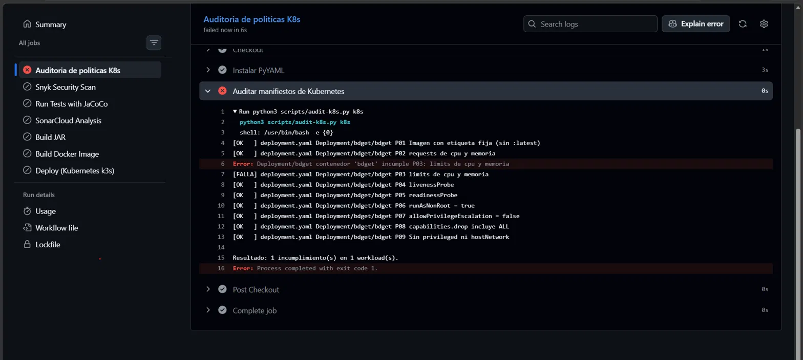
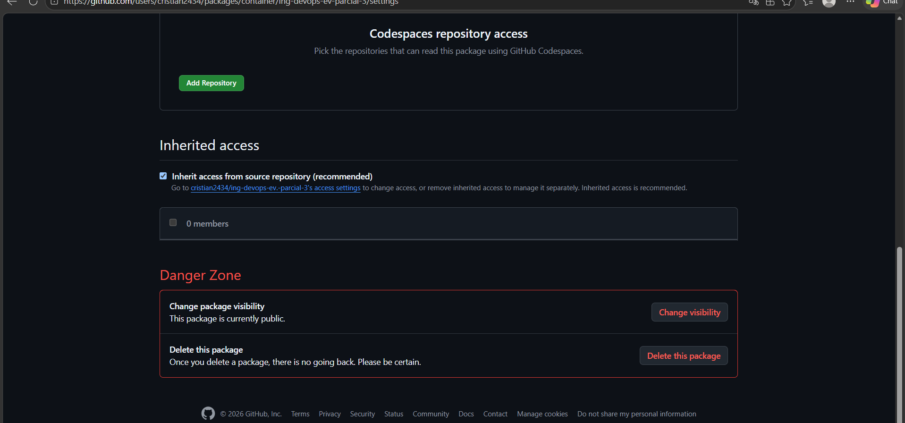

---

## Observabilidad y monitoreo (IE1, IE3)

Se eligió **AWS CloudWatch** como plataforma de monitoreo porque la instancia EC2 ya tiene el rol del laboratorio (`LabInstanceProfile`), lo que evita manejar credenciales y mantiene el consumo de memoria bajo en una instancia pequeña. La aplicación además expone `/actuator/prometheus` (Micrometer) y el Deployment lleva las anotaciones `prometheus.io/*`, de modo que se puede conectar un Prometheus sin cambiar la aplicación. **En esta entrega no se instaló un servidor Prometheus**: las métricas se visualizan en CloudWatch.

| Qué se observa | Cómo se obtiene | Dónde se ve |
|---|---|---|
| CPU de la instancia | Métrica nativa `AWS/EC2 · CPUUtilization` | Dashboard y alarma |
| Memoria y disco | Agente de CloudWatch (`mem_used_percent`, `disk_used_percent`) | Dashboard |
| Logs de la aplicación | El agente lee `/var/log/pods/bdget_*/bdget/*.log` y los envía al grupo `/bdget/app` | Widget de logs del dashboard |
| Errores registrados | Metric filter `bdget-errores` (patrón `ERROR`) → métrica `Bdget/ErroresApp` | Dashboard |
| Disponibilidad | Un temporizador de systemd consulta `/actuator/health` cada minuto y publica `Bdget/HealthUp` (1 = UP, 0 = DOWN) | Dashboard |
| Tiempo de despliegue | El job `deploy` mide el tiempo y lo publica como `Bdget/Pipeline · DeployDurationSeconds` | Dashboard |
| Cobertura de pruebas | El job `test` calcula la cobertura desde JaCoCo y el job `deploy` la publica como `CoveragePercent` | Dashboard |

El dashboard **Bdget-Observabilidad** está versionado en `monitoring/dashboard.json` y el pipeline lo publica en cada despliegue con `aws cloudwatch put-dashboard` (`scripts/publish-observability.sh`). Así, el panel se reconstruye solo desde el repositorio. En la última medición el despliegue tardó **56 s** y la cobertura fue de **100 %**.

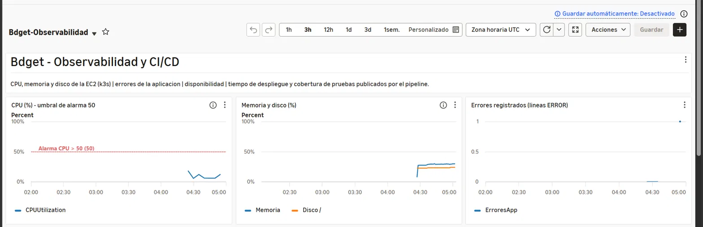
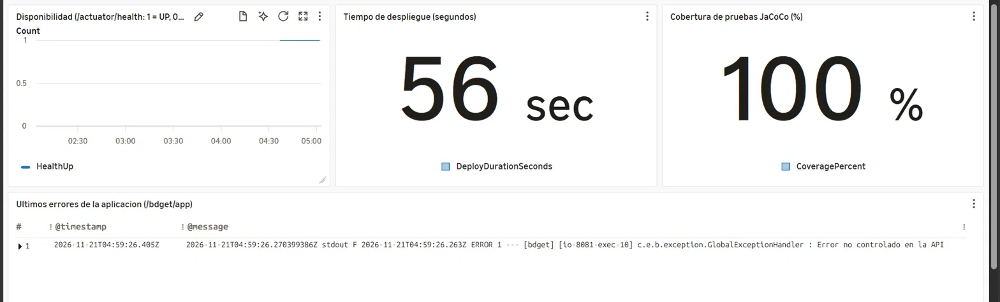

### Alertas
Se creó la alarma `Alarma-CPU-50-ec2-devops` (CPU promedio mayor a 50 % durante 5 minutos) conectada al tema SNS `SNS-Alertas-DevOps`, con una suscripción de correo confirmada. Para validarla se generó carga con `stress-ng --cpu 2 --timeout 420s`: la CPU subió sobre 90 %, la alarma pasó a **En modo alarma** y llegó el correo de aviso. Al terminar la carga volvió a **Correcto**.

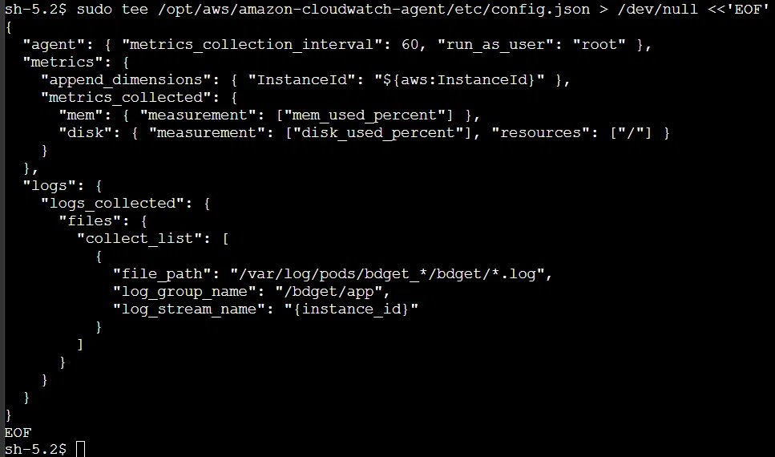
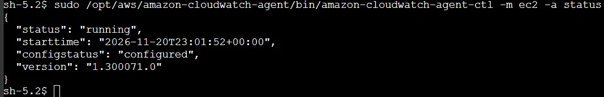
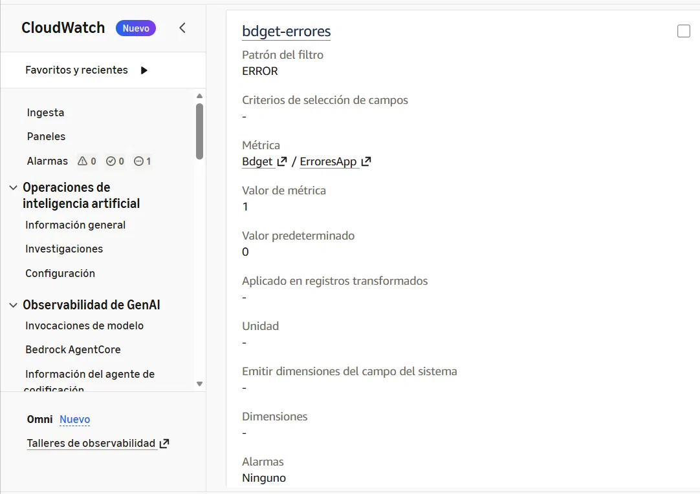
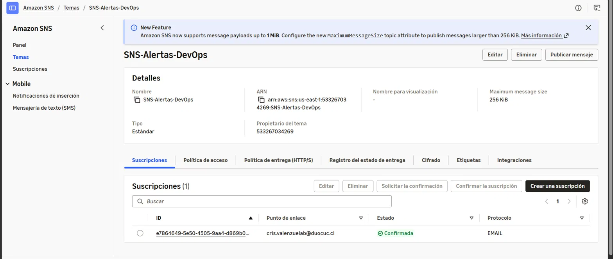
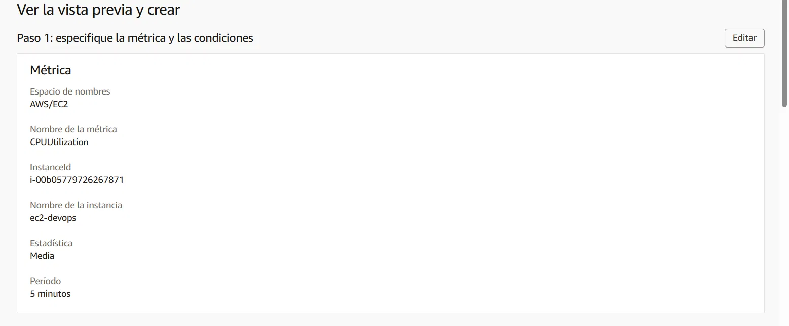
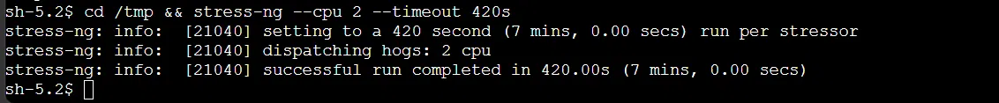
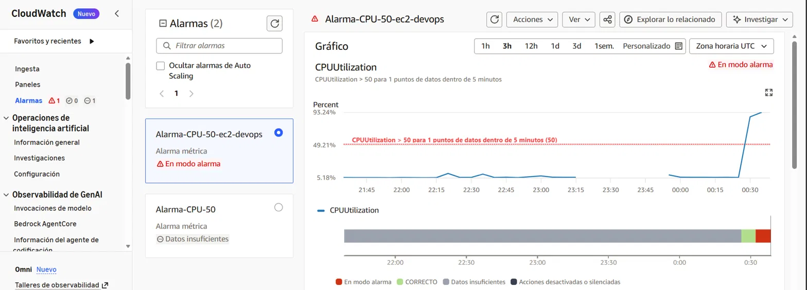
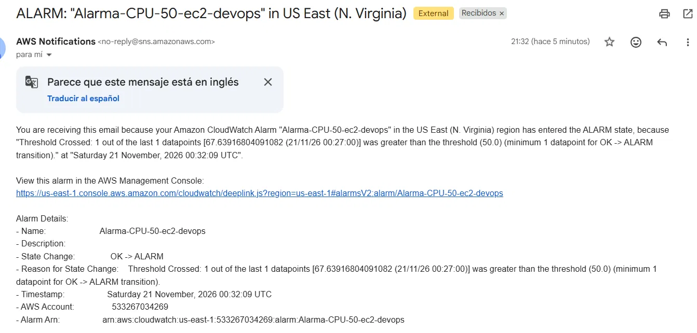

---

## Políticas de cumplimiento (IE5)

Las políticas se aplican de forma automática; ninguna depende de una revisión manual:

1. **Auditoría de manifiestos de Kubernetes** (`scripts/audit-k8s.py`). Revisa cada contenedor y escribe una tabla en el resumen del job:

   | Política | Regla |
   |---|---|
   | P01 | Imagen con etiqueta fija (sin `:latest`) |
   | P02 | `requests` de CPU y memoria |
   | P03 | `limits` de CPU y memoria |
   | P04 | `livenessProbe` definida |
   | P05 | `readinessProbe` definida |
   | P06 | `runAsNonRoot = true` |
   | P07 | `allowPrivilegeEscalation = false` |
   | P08 | `capabilities.drop` incluye `ALL` |
   | P09 | Sin `privileged` ni `hostNetwork` |

2. **Escaneo de la imagen con Trivy** antes de publicarla. Los dos CVE de Spring Framework sin parche de código abierto (CVE-2026-47884 y CVE-2026-47890) están aceptados en `.trivyignore` con **fecha de vencimiento (31-01-2027)**: pasada la fecha, Trivy vuelve a bloquear y obliga a revisarlos. La API solo tiene controladores REST, sin `XsltView`, vistas ni Server-Sent Events, que es lo que esas vulnerabilidades requieren. Cualquier otro hallazgo crítico con parche sigue bloqueando.
3. **Snyk, JaCoCo y SonarCloud** como se describe en las secciones siguientes.
4. **Ruleset `proteger-main`** (activo, sin excepciones): exige Pull Request, bloquea los force push y exige **cinco checks obligatorios**: `Snyk Security Scan`, `Run Tests with JaCoCo`, `SonarCloud Analysis`, `Auditoria de politicas K8s` y `Build Docker Image` (este último incluye el escaneo de Trivy).

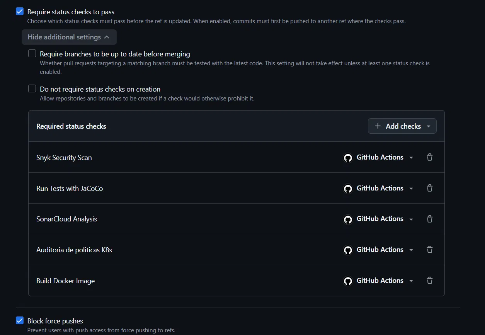
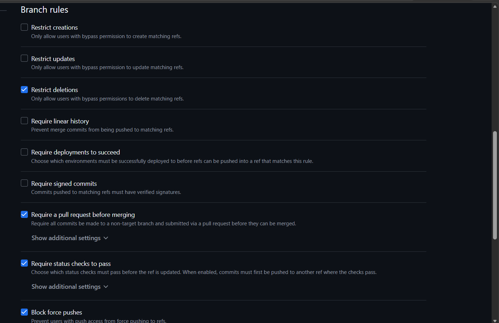
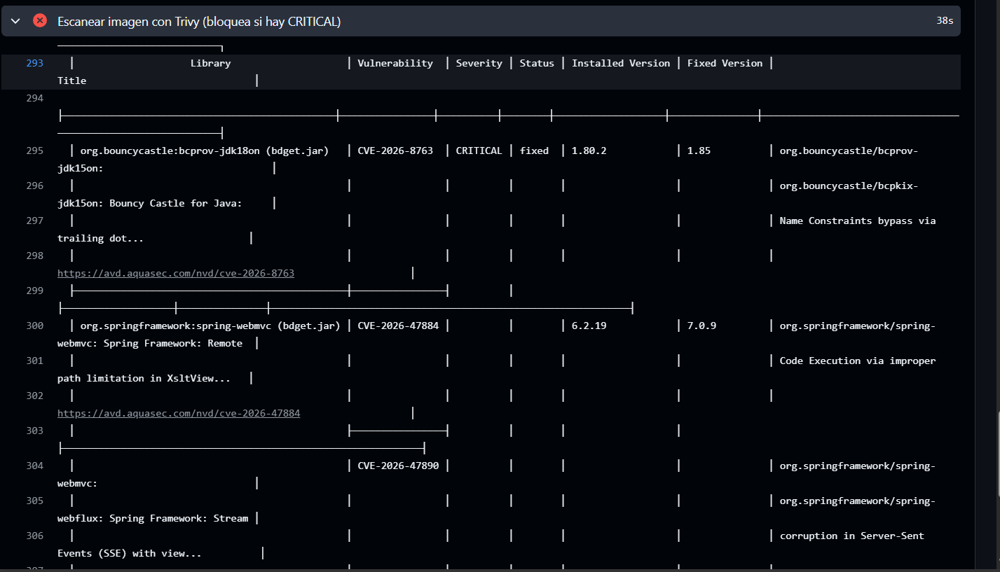

### Seguridad y bloqueos
- **Dependabot** (`.github/dependabot.yml`) revisa semanalmente Maven, GitHub Actions y Docker y abre Pull Requests con las actualizaciones. Los saltos mayores (por ejemplo, Spring Boot 4) no se aplican automáticamente: se evalúan antes del merge.
- **Snyk** bloquea el pipeline si encuentra vulnerabilidades altas o críticas.
- **SonarCloud** analiza la calidad del código y el pipeline espera su Quality Gate.

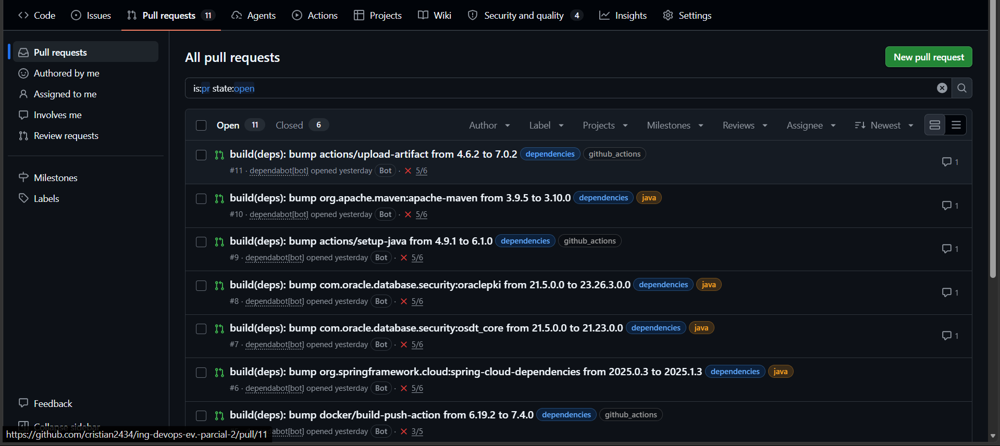
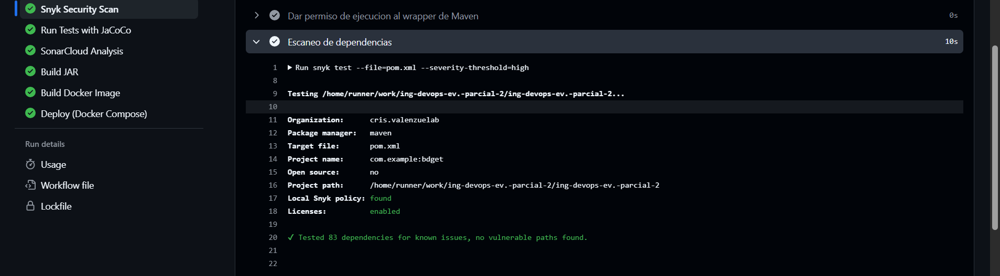
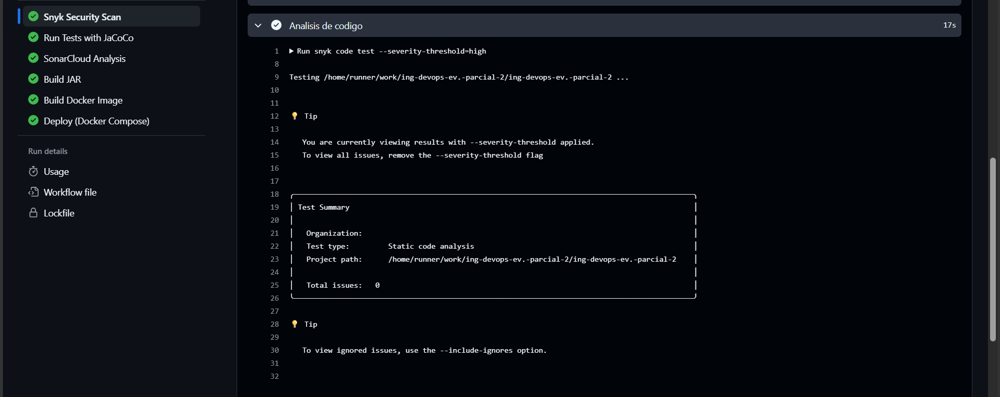

#### Hallazgos corregidos sin migrar de versión
El 30-10-2026 Snyk detectó 5 hallazgos nuevos de severidad alta o crítica (4 en `tomcat-embed-core` 10.1.55 y 1 en `jackson-databind` 2.21.4) y bloqueó el pipeline. Como existía corrección dentro de la misma versión mayor, se resolvieron fijando `tomcat.version=10.1.61` y `jackson-bom.version=2.21.8` en el `pom.xml`, sin migrar a Spring Boot 4 ni agregar excepciones al `.snyk`.

#### Riesgo aceptado temporalmente (`.snyk`)
Tras actualizar a Spring Boot 3.5.15, Spring Cloud 2025.0.3 y JaCoCo 0.8.14, el escaneo bajó de 82 a **43 hallazgos** de severidad alta o crítica (Tomcat, Spring Framework, Logback, BouncyCastle y otras librerías internas de Spring). En todos, la corrección solo existe en **Spring Boot 4.0.0** (o Spring Cloud Config 5.0.5, que también exige Boot 4).

Migrar a Spring Boot 4 es un cambio mayor (otra versión de Hibernate y Jackson, cambios en las pruebas), que queda **fuera del alcance de esta evaluación**. Por eso estos 43 hallazgos están registrados en el archivo `.snyk`, cada uno con su motivo y una **fecha de vencimiento (31 de enero de 2027)**. No son vulnerabilidades inexistentes, sino **riesgo aceptado de forma temporal y documentada**, con el plan de migrar a Spring Boot 4. Cualquier hallazgo alto o crítico **nuevo** que no esté en esa lista sigue bloqueando el pipeline; las demostraciones de la sección siguiente lo comprueban.

### Calidad
- La política de calidad exige **al menos 70 % de cobertura de líneas** (JaCoCo, regla `check` en el `pom.xml`). Si baja de ese valor, `mvn verify` falla y el pipeline se detiene.
- Las 19 pruebas unitarias cubren las capas controller, service, model y el manejador global de excepciones, además del endpoint de salud.
- SonarCloud midió **100 % de cobertura**, **0 % de duplicación** y el Quality Gate en estado **Passed**.

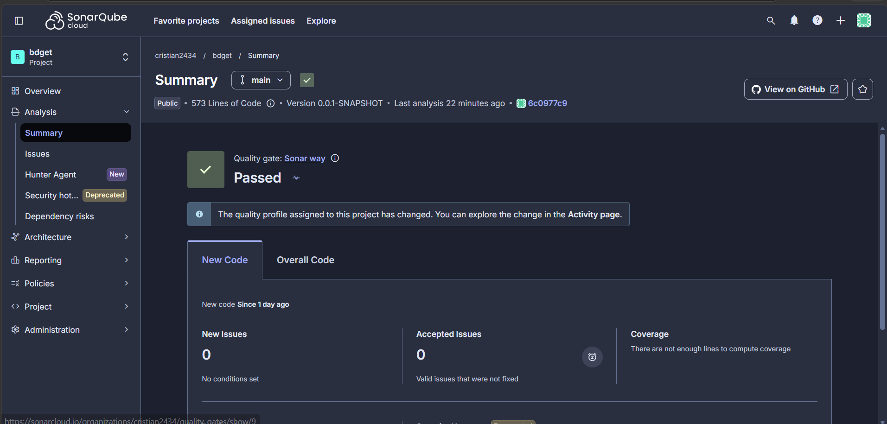
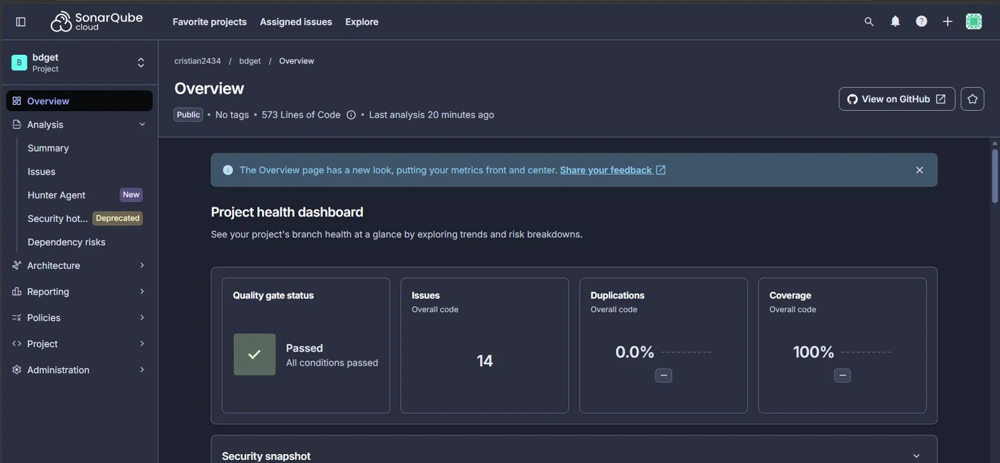

---

## Demostración: el pipeline se detiene ante una falla crítica (IE6)

Se provocaron fallas reales y en cada caso el pipeline se detuvo antes de llegar al despliegue, con los jobs siguientes omitidos.

| Caso | Qué pasó | Evidencia |
|---|---|---|
| **Seguridad: Snyk** | Se detectaron vulnerabilidades altas o críticas en las dependencias y el job falló. | Ver capturas de Snyk más arriba y el run antes/después con la corrección de Micrometer |
| **Calidad: SonarCloud** | El Quality Gate falló por **Security Rating C** (una regla sobre la instalación de PyYAML en `main.yml`). Tras resolverlo, el Quality Gate pasó. | `ie6-sonar-*` |
| **Seguridad: Trivy** | La imagen tenía vulnerabilidades críticas. El job `Build Docker Image` falló y la imagen **no se publicó en GHCR**. Tras corregir lo que tenía parche y aceptar con vencimiento las dos sin parche, el pipeline quedó en verde. | `ie5-trivy-tabla-criticos`, `ie6-trivy-falla-jobs-saltados`, `ie6-pipeline-verde-trivy-ok` |
| **Política: auditoría K8s** | En la rama temporal `demo/falla-politica` (Pull Request #19, cerrado sin merge) se quitó el bloque `limits` del Deployment. La auditoría falló en **P03**, los otros 6 jobs quedaron omitidos y GitHub **bloqueó el botón de merge**. | `ie6-politica-*` |

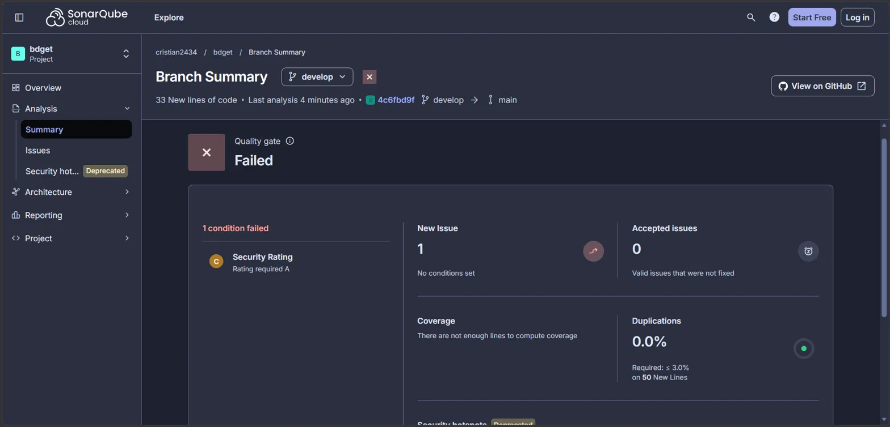
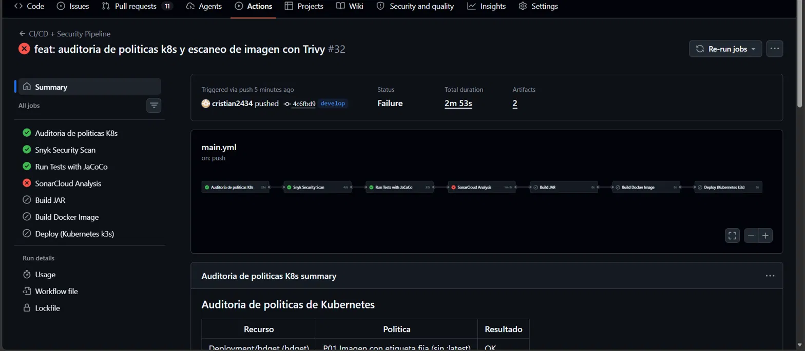
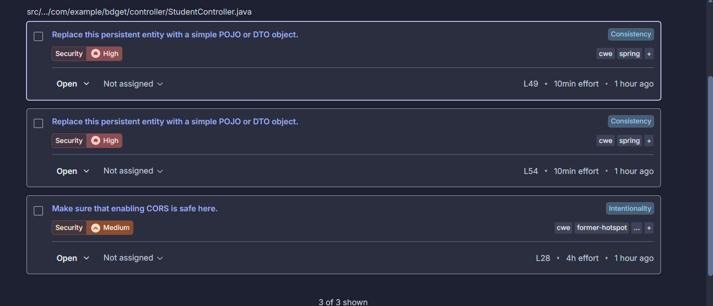
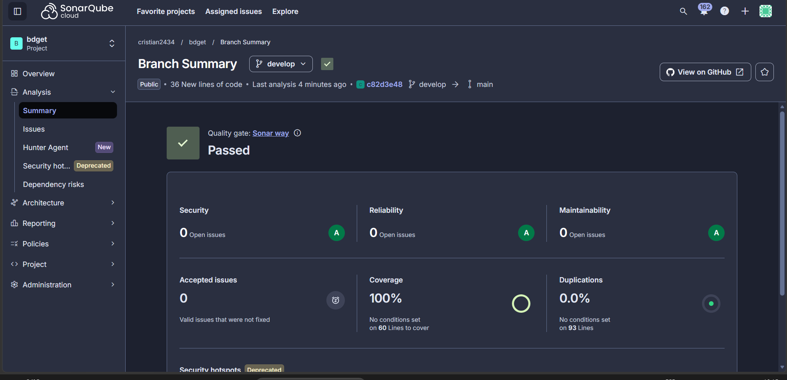
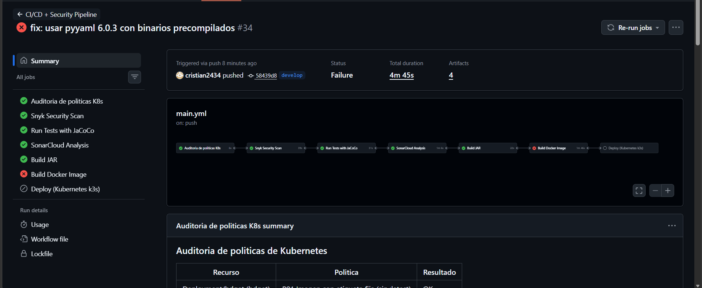

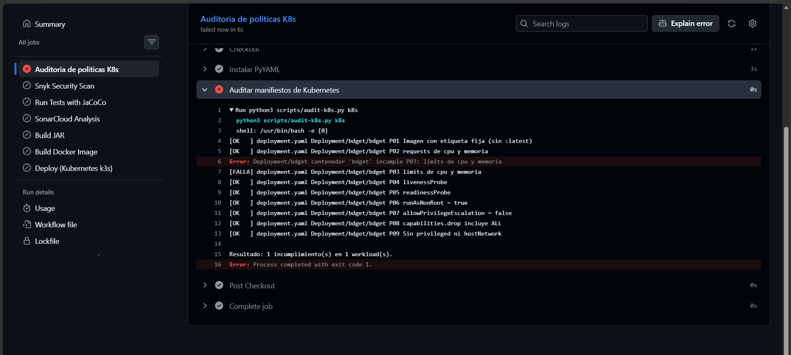
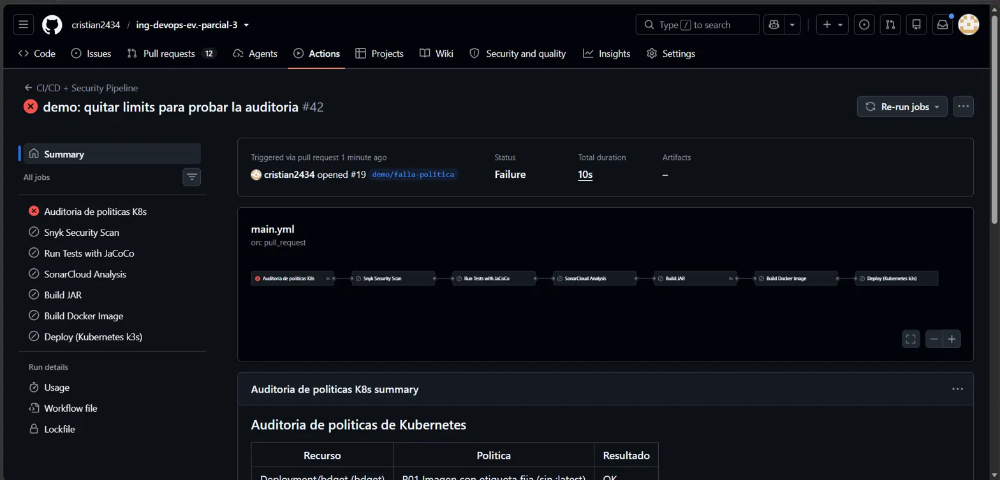
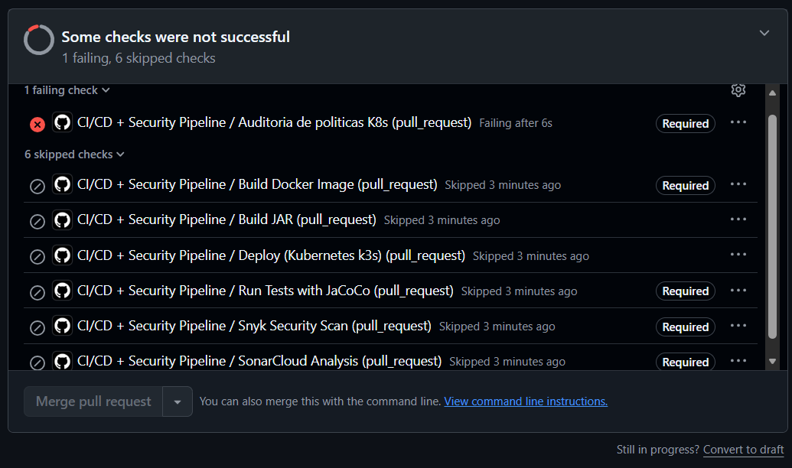

---

## Decisiones técnicas que habilitan las métricas (IE4)

| Métrica o señal | Umbral | Decisión técnica |
|---|---|---|
| **Cobertura de pruebas** (JaCoCo) | Menos de 70 % | `mvn verify` falla, el pipeline se detiene y el Pull Request no se puede mergear. Se deben agregar pruebas antes de continuar. El dashboard muestra la tendencia: la medición actual es 100 %, lo que deja margen para agregar código nuevo. |
| **CPU de la instancia** | Más de 50 % durante 5 minutos | La alarma envía un correo por SNS. Se revisa el dashboard para ver si es un pico o un patrón; si es sostenido, se evalúa subir los `limits` de CPU del Deployment, aumentar las réplicas o cambiar el tamaño de la instancia. La prueba con `stress-ng` mostró que la alerta llega. |
| **Errores registrados** (`ErroresApp`) | Mayor que 0 | El panel de logs del dashboard muestra la línea exacta. Se corrige el error en una rama `hotfix/*` o se ajusta el manejo de excepciones; el pipeline valida el arreglo antes de volver a desplegar. |
| **Disponibilidad** (`HealthUp`) | 0 (DOWN) | Indica caída del servicio o de la base de datos Oracle. Durante un despliegue, si el rollout falla, el pipeline ejecuta `rollout undo` y deja la versión anterior funcionando. |
| **Tiempo de despliegue** | 56 s en la última medición | Sirve de línea base: si aumenta de forma sostenida, se revisa la causa (tamaño de la imagen, tiempo de arranque de la aplicación o de las probes). |
| **Vulnerabilidades críticas** (Snyk y Trivy) | Cualquier hallazgo nuevo con parche | Se bloquea el pipeline. Si no existe parche, se acepta de forma explícita con motivo y fecha de vencimiento, para que la decisión se revise y no quede olvidada. |

---

## Secretos requeridos en GitHub
En `Settings → Secrets and variables → Actions`:

| Secreto | Uso |
|---|---|
| `SNYK_TOKEN` | Autenticación de Snyk |
| `SONAR_TOKEN` | Autenticación de SonarCloud |
| `DB_TNS_ALIAS` | Alias TNS de la base Oracle (por ejemplo, `pruebadb_high`) |
| `DB_USERNAME` | Usuario de la base de datos |
| `DB_PASSWORD` | Contraseña de la base de datos |
| `DB_WALLET_ZIP_B64` | Wallet de Oracle en ZIP codificado en base64 |
| `EC2_HOST` | IP pública (elástica) de la instancia EC2 de despliegue |
| `EC2_SSH_KEY` | Llave privada SSH (`.pem`) para conectarse a la EC2 |
| `EC2_USER` (opcional) | Usuario SSH de la EC2; si no existe se usa `ec2-user` |

El wallet contiene solo `cwallet.sso`, `tnsnames.ora` y `sqlnet.ora`, con `sqlnet.ora` apuntando a `/app/wallet`, donde el Deployment lo monta. Ningún secreto ni el wallet están en el repositorio.

## Trazabilidad
- Cada imagen se publica en GHCR etiquetada con el **SHA del commit** y con `latest`, y lleva labels OCI (`revision`, `source`).
- El nombre de la imagen es fijo: `ghcr.io/cristian2434/ing-devops-ev-parcial-3`. No se usa el nombre del repositorio porque este contiene `.-`, una combinación que Docker no acepta en una referencia de imagen.
- El Deployment usa exactamente la imagen construida en ese mismo run, y el resumen del despliegue registra el commit, la imagen, el tiempo y la cobertura.
- Todo cambio llega a `main` por Pull Request: commit → PR → ejecución del pipeline → imagen → despliegue.

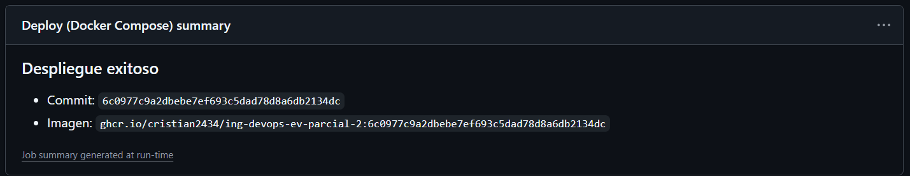
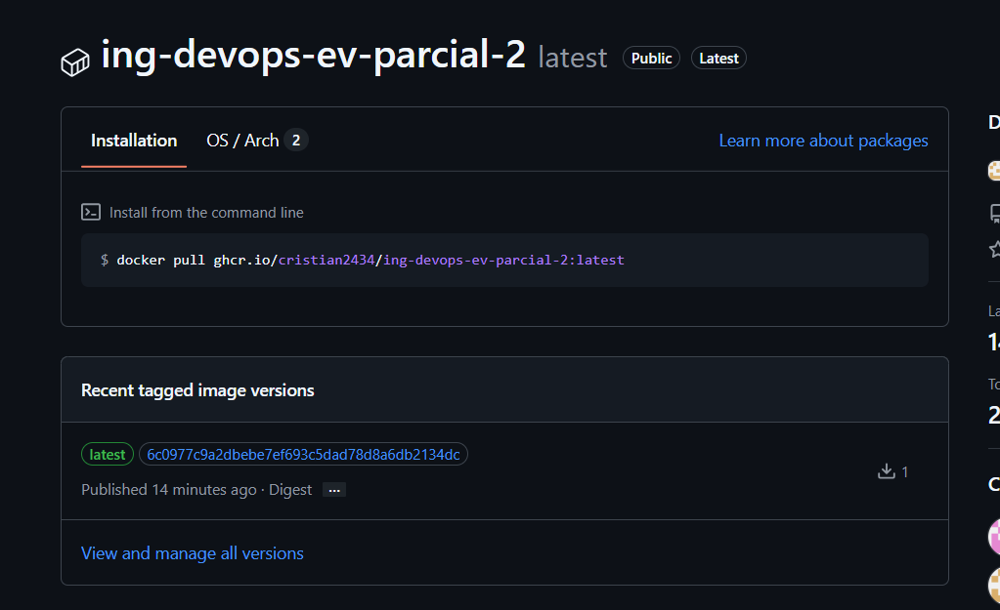

## Entorno de despliegue en AWS EC2
- **AMI:** Amazon Linux 2023, tipo **`t3.medium`** (4 GB de RAM, necesarios para k3s, la aplicación y el agente), con IP elástica.
- **Security Group:** entrada TCP 22 (SSH, usado por el pipeline), TCP 8081 (la API) y TCP 80 (página web en Apache).
- **Preparación única de la instancia:**
```bash
# k3s sin Traefik (el puerto 80 lo usa Apache)
curl -sfL https://get.k3s.io | INSTALL_K3S_EXEC="--disable traefik" sh -
sudo k3s kubectl get nodes

# Apache para la página web
sudo dnf install -y httpd
sudo systemctl enable --now httpd

# Agente de CloudWatch
sudo dnf install -y amazon-cloudwatch-agent
```
- **Verificación:** la prueba de humo corre dentro de la EC2 contra `http://localhost:8081/api/health`, evitando tráfico HTTP en claro por internet. En la instancia también se puede revisar con `sudo kubectl get pods -n bdget` y `curl http://localhost:8081/actuator/health`.
- **Limitación conocida:** el SSH está abierto a cualquier IP porque los runners de GitHub no tienen IP fija; el acceso queda protegido por la llave privada, que solo existe como secreto del repositorio.
- **Laboratorio:** al terminar cada sesión se detienen los recursos de AWS Academy.

---

## Funcionalidades agregadas en este trabajo

- **Búsqueda de estudiantes por nombre**: endpoint `GET /students/search?name=` (búsqueda parcial, insensible a mayúsculas/minúsculas), implementado en las capas Repository, Service y Controller, con su test unitario correspondiente.
- **Health Check**: endpoint `GET /api/health` que retorna el estado del servicio, usado por las probes de Kubernetes y por la prueba de humo del despliegue.
- **Hotfix**: corrección en `GlobalExceptionHandler` para capturar la ruta real donde ocurre un error no controlado (antes no se informaba el endpoint afectado), además de limpieza de imports duplicados.
- **Página web de despliegue**: `web/index.html`, página estática que resume el pipeline y se publica automáticamente en Apache desde el job `deploy`.
- **Observabilidad**: `spring-boot-starter-actuator` y `micrometer-registry-prometheus`; se exponen solo `health`, `info` y `prometheus`.
- **Cumplimiento**: `scripts/audit-k8s.py` (9 políticas sobre los manifiestos) y escaneo de la imagen con Trivy.
- **Despliegue**: manifiestos de Kubernetes en `k8s/` y dashboard de CloudWatch en `monitoring/dashboard.json`.

## Declaración de Uso de Inteligencia Artificial

Se utilizó IA (Claude, de Anthropic) como apoyo técnico en las evaluaciones 2 y 3. En la **Evaluación 3** se usó para:
- Orientar el paso a paso de la instalación de k3s en la EC2 y generar el borrador de los manifiestos de `k8s/` y de los cambios al workflow para desplegar en Kubernetes.
- Generar el borrador del script de auditoría `scripts/audit-k8s.py`, del script `publish-observability.sh`, del `dashboard.json` y de la integración de Trivy.
- Guiar la configuración de CloudWatch (agente, metric filter, alarma y SNS) y de las demostraciones de falla del pipeline.
- Ayudar a diagnosticar errores (por ejemplo, el archivo `.trivyignore` que no se estaba subiendo al repositorio).
- Redactar un borrador de las secciones técnicas de este README y revisar ortografía.

En la **Evaluación 2** se usó para la plantilla del workflow, el `Dockerfile`, el `docker-compose.yml`, `dependabot.yml`, pruebas unitarias adicionales, la orientación sobre Snyk y SonarCloud y la página `web/index.html`.

Todo el contenido generado fue revisado, ejecutado y validado por mí: el pipeline corrió completo en `main`, el pod quedó en Running y las alarmas y el dashboard se probaron en AWS. **Las conclusiones y la reflexión personal fueron redactadas sin apoyo de IA.** Más información sobre uso ético de IA: https://bibliotecas.duoc.cl/ia

## Conclusiones y Reflexión Personal

### Evaluación 3

Cristian Valenzuela: Aprendí la diferencia entre monitorear si un sistema funciona y tener observabilidad para entender por qué falla usando métricas y logs. Antes trabajaba con Docker Compose, y ahora aprendí a desplegar microservicios en un entorno orquestado con Kubernetes (k3s) y a usar Amazon CloudWatch junto al agente de CloudWatch para recolectar métricas como CPU o memoria y enviar logs. También conocí cómo configurar un dashboard con métricas clave, aplicar auditorías o políticas de cumplimiento en el repositorio/pipeline y escaneo de vulnerabilidades con Trivy.

Entendí que una alarma con notificaciones (como CloudWatch + SNS) sirve para detectar anomalías a tiempo antes de que afecten al sistema, y que configurar el pipeline para que se detenga automáticamente ante una falla crítica de seguridad o calidad evita que código con errores llegue a producción.

Yo aporté en el despliegue de los microservicios en Kubernetes (k3s), la configuración del monitoreo y la alarma de CPU con notificaciones por SNS en CloudWatch, la creación del dashboard con las métricas del proyecto y las demostraciones de falla para comprobar que el pipeline se bloquea cuando no se cumple con la seguridad o la calidad.

### Evaluación 2

Cristian Valenzuela: Aprendí que el pipeline crea una imagen o varias imágenes a través de Docker. También entendí que existen varias herramientas para las pruebas unitarias, y no sabía que existía JaCoCo, porque antes había trabajado solo con JUnit, que ejecuta las pruebas, y con Mockito, que crea objetos simulados para aislar lo que se prueba. Tampoco sabía que Dependabot sirve para escanear las dependencias del proyecto, ni que para analizar el código se usa SonarQube o Snyk, o ambos a la vez. Además, aprendí a hacer el despliegue automático a través de Docker Compose y a reforzar cómo crear el GitHub Actions en la rama main, agregando más ramas si uno quiere.

En el Docker Compose puedo implementar una orquestación de contenedores, según el caso, para asegurar la estabilidad y la calidad.

Decidí aceptar los riesgos con fecha de vencimiento en lugar de migrar a Spring Boot 4.

Yo aporté en la implementación del pipeline de GitHub Actions con la construcción de la imagen con Docker, la ejecución de pruebas unitarias con JUnit (JaCoCo mide cuánto código cubren esas pruebas), la implementación de la orquestación de contenedores, el aseguramiento de la estabilidad y la calidad del sistema, la configuración de alertas o bloqueos si el análisis de seguridad falla y la configuración del Dockerfile de mi microservicio.

### Evaluación 1 (referencia)

Cristian Valenzuela: aprendi que existe diferentes tipos de ramas que antes no conocia. Ahora se que la rama feature se usa solo para agregar una nueva funcionalidad al proyecto; nunca habia trabajado con las ramas feature y hotfix antes. Antes solo usaba el main y a lo más creaba una rama extra para trabajar en un proyecto. 

Yo antes habia trabajado el hacer pull request para hacer la conexion con la rama main y tuve que aprender hacer cambios significativos para ver como funciona. 

Entendi la diferencia entre feature y hotfix que uno es para nueva funcionalidad y el otro para corregir errores urgentes. Tambien fue dificil al inicio trabajar solo pero después me acostumbre.